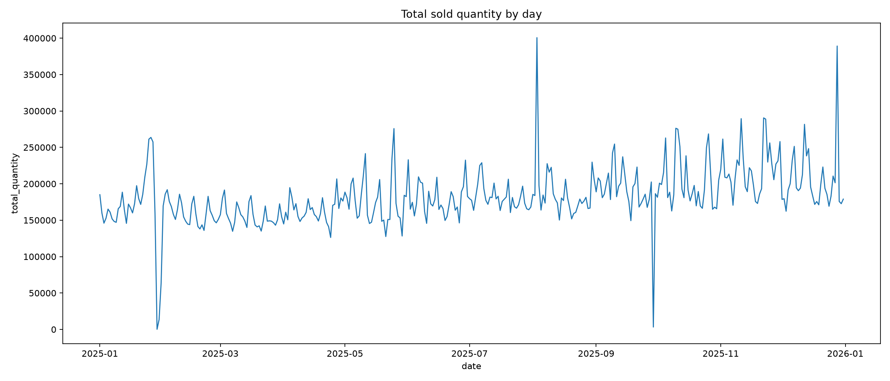
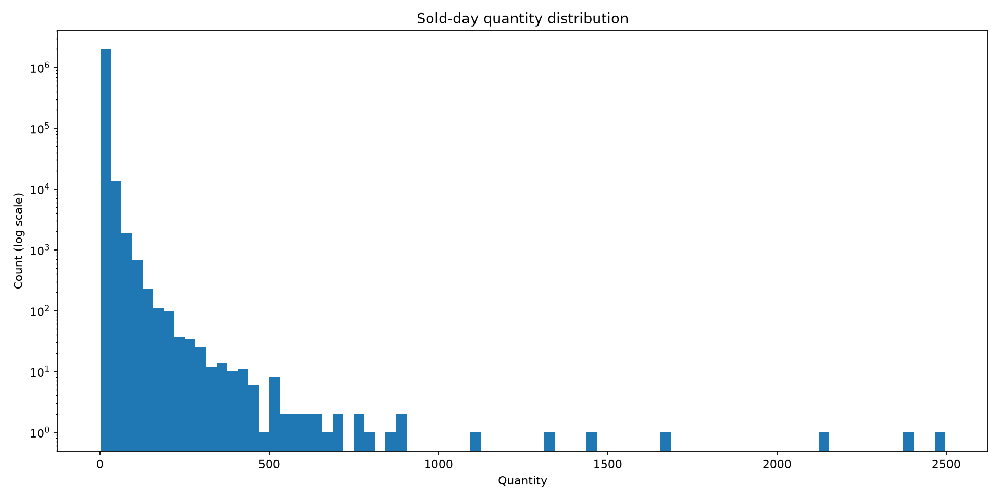
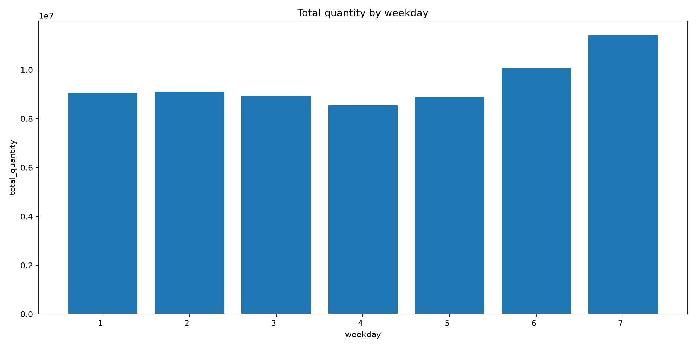
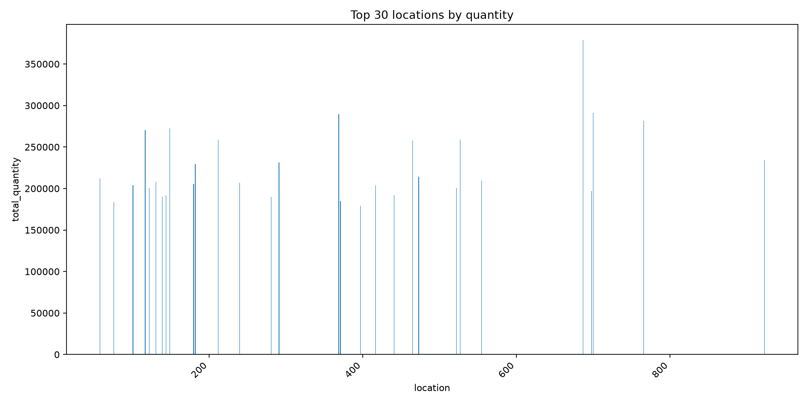

# Sales Forecasting Pipeline

[](https://github.com/hyytrnn/sale-forecasting/actions/workflows/tests.yml)

This repository contains a reproducible sales forecasting notebook and the Python modules that the notebook writes before executing the pipeline. The task is to estimate the monthly quantity sold for every `(location, item_id)` pair.

## Project snapshot

| | Details |
| --- | --- |
| Problem | Monthly demand forecasting for retail location–item pairs |
| Data scale | 41.5M transaction rows, 1,038 locations, 29,823 item records |
| Modeling | Hurdle-style CatBoost experiment; recorded selected config behaves as a scaled quantity regressor |
| Feature design | Multi-level rolling demand, recency, categorical metadata, and share features |
| Validation | December 2025 holdout with a custom non-zero MAPE score |
| Historical score | 60.2592 full December evaluation; produced before the sampling correction and awaiting rerun |
| Deliverables | Notebook, reproducible EDA script, charts, ranked tables, and feature documentation |

This is a strong portfolio project for demonstrating data engineering, exploratory analysis, feature engineering, and machine learning on a large tabular forecasting problem. The raw transaction files remain local because they contain transaction-level fields and are too large for a public source repository.

The main notebook is [`sale_forecasting.ipynb`](./sale_forecasting.ipynb). It preserves the original experiment and outputs. The maintainable implementation is versioned under [`src/sales_forecasting/`](./src/sales_forecasting/).

## Project structure

The notebook originally generated these modules. They are now importable and versioned in `src/sales_forecasting/`:

| Module | Purpose |
| --- | --- |
| `src/sales_forecasting/project_paths.py` | Portable data/output configuration using environment variables and local defaults. |
| `src/sales_forecasting/train_predict.py` | Builds features, performs corrected sampling, trains models, and scores predictions. |
| `src/sales_forecasting/train_predict_decval.py` | Runs validation, tuning, full-grid prediction, retraining, and artifact export. |
| `src/sales_forecasting/train_predict_decval_v2.py` | Defines the recorded v2 experiment defaults. |
| `src/sales_forecasting/prepare_cache.py` | Builds `daily_quantity.parquet` with a streaming Polars aggregation. |
| `src/sales_forecasting/make_subset.py` | Creates a smaller data subset for local experiments. |
| `src/sales_forecasting/eda.py` | Produces the original descriptive tables and plots. |
| `src/sales_forecasting/evaluator.py` | Implements the benchmark score and zero-aware evaluation metrics. |
| `src/sales_forecasting/fix_submission_pickle.py` | Normalizes submission columns and dtypes before delivery. |
| `scripts/run_eda.py` | Rebuilds the daily cache and generates the tracked EDA tables and charts. |

Sampling correctness and metric behavior are covered by [`tests/`](./tests/), and GitHub Actions runs unit tests plus a synthetic EDA smoke test.

## Data used by the pipeline

The pipeline expects three Parquet inputs:

- `transaction_full_2025.parquet`: transaction-level sales events.
- `items.parquet`: item metadata and active-sale status.
- `event_full_2025.parquet`: optional event data used when creating a subset.

The transaction data must provide at least `location`, `item_id`, `updated_date`, `event_type`, and `quantity`. The item table supplies `item_id`, `sale_status`, `price`, `category_l1`, `category_l2`, `category_l3`, `category`, `brand`, `manufacturer`, and `size`.

Raw data is not committed to this repository. Place equivalent Parquet files under `data/` or configure `SALES_FORECASTING_DATA_DIR`. The pipeline filters `event_type == "Purchase"`, casts IDs to strings, converts timestamps to calendar dates, and aggregates quantity by `(location, item_id, date)`.

The recorded run found 1,038 locations, 6,850 active items, and 7,110,300 possible location-item pairs. Seven known anomalous dates are excluded from training and evaluation:

`2025-01-29`, `2025-01-30`, `2025-01-31`, `2025-07-04`, `2025-07-18`, `2025-09-29`, and `2025-10-27`.

## Exploratory data analysis

The EDA implementation reads the daily quantity table and keeps non-zero sold pair-days. It produces:

- an overview containing the date range, number of locations, items, pairs, total quantity, mean, median, P90, P99, and maximum quantity;
- pair-level summaries with first/last sale dates, active days, total quantity, dispersion, coefficient of variation, and gaps between sales;
- IQR-based high-outlier days for each pair;
- ranked CSV tables for pairs, locations, items, dates, weekdays, volatile pairs, and intermittent pairs;
- PNG plots for daily totals, active pairs, weekday totals, top locations, top items, quantity distribution, active-day distribution, and pair activity versus total quantity.

Outputs are written under `eda/`. The notebook defines this EDA module but the main training cell does not execute it automatically; run `python eda.py` after the daily cache exists when EDA artifacts are needed.

This repository also includes the generated report under [`reports/eda/`](./reports/eda/). The report is based on the local Parquet archive and contains the overview, ranked tables, daily and weekday summaries, and PNG charts. The observed EDA snapshot covers 35,324,041 non-zero pair-days, 3,144,558 sold location-item pairs, 1,038 locations, and 20,393 items.

Key charts:

<table>
<tr>
<td></td>
<td></td>
</tr>
<tr>
<td></td>
<td></td>
</tr>
</table>

Additional charts and the complete CSV tables are available in [`reports/eda/`](./reports/eda/), including [`top_items_quantity.png`](./reports/eda/top_items_quantity.png) and [`pair_active_days_distribution.png`](./reports/eda/pair_active_days_distribution.png).

The feature definitions and their modeling roles are documented in [`docs/feature_analysis.md`](./docs/feature_analysis.md).

## Feature engineering

For each target month, features are calculated using data available on the previous day. The pipeline builds rolling aggregates over 30, 60, 90, 180, and 365 days at several levels:

- `(location, item_id)` pair;
- item;
- location;
- `category_l1` and `category_l2`;
- brand;
- `(location, category_l1)`.

Each level contributes quantity totals, active-day counts, and recency. Date recency is converted to `days_since_sale`; missing numeric values become zero and missing categorical values become `unknown`. Additional features include recent location shares and pair-to-location/item shares. The target month number and number of calendar days are also included.

## Model and training procedure

The implementation supports a two-stage CatBoost approach:

1. **Positive-sale classifier** — `CatBoostClassifier` with Logloss and AUC. It predicts whether a location-item pair has positive quantity.
2. **Positive-quantity regressor** — `CatBoostRegressor` trained only on positive rows with raw quantity targets and MAPE loss.

Both models use categorical features such as location, item, category, brand, manufacturer, and size. The recorded run uses CPU training, seed `42`, depth `8`, learning rate `0.06`, 700 classifier iterations, and 900 regressor iterations. The optional quantity-bucket classifier is disabled in the recorded command.

Training data is built month by month from April through November 2025. Each month samples up to 120,000 positive pairs and 240,000 negative pairs, giving 2,880,000 training rows and 109 columns in the recorded run. Corrected negative sampling anti-joins against all observed positive keys before positive downsampling and maintains unique accumulated negative keys.

December positive rows are used as the validation set, capped at 300,000 rows. The project score is:

```text
score = 100 - mean(abs(actual - predicted) / abs(actual)) * 100
```

Only non-zero actual quantities contribute to this benchmark score. The validation search tunes the prediction scale and related CatBoost controls. The historical notebook selected `scale=0.67`, `proba_power=0.0`, and `threshold=0.0`, so classifier probability did not affect its selected final quantity prediction.

After validation, the models are retrained through December 2025. January 2026 predictions are generated for the full location-item grid in batches of 40 locations. The effective recorded formula was approximately `round(max(0, regressor_quantity) * 0.67)`. See [`docs/model_card.md`](./docs/model_card.md) for the distinction between the experimental architecture and selected configuration.

## Notebook execution

### Install dependencies

```bash
python -m venv .venv
# Windows PowerShell
.\.venv\Scripts\Activate.ps1
python -m pip install -e .
python -m pip install -r requirements-dev.txt
```

Run the public synthetic smoke workflow without private data:

```bash
python scripts/generate_sample_data.py --output-dir sample-data
python scripts/run_eda.py --data-dir sample-data --output-dir smoke-report --top-n 5
python -m pytest -q
```

For a smaller local test, first run `make_subset.py` and use its generated paths with reduced iteration and sample settings. To reproduce the tracked EDA artifacts from the project root, run:

```bash
python scripts/run_eda.py --data-dir data --output-dir reports/eda
```

For a full model run, ensure the Parquet files are available and enough memory and storage exist for the daily cache, model files, validation report, and full-grid submission.

The corrected full model entry point is:

```bash
python -m sales_forecasting.train_predict_decval_v2 --task-type CPU
```

Use `SALES_FORECASTING_DATA_DIR` and `SALES_FORECASTING_OUTPUT_DIR` to override local paths. A full run is computationally expensive; the historical notebook took about 4.4 hours on CPU.

## Recorded outputs

The original notebook run recorded:

- December score after the full-grid evaluation: `60.2592`;
- January submission rows: `7,110,300`;
- January non-zero predictions: `7,110,273`;
- January predicted quantity sum: `8,621,707`;
- normalized submission schema: `location` as `int32`, `item_id` as `object`, and `quantity` as `int64`.

These scores are historical pre-fix evidence, not results from the corrected sampling implementation. Full retraining is required before reporting a new score. The run writes model checkpoints, `validation_report.csv`, December and January submission pickles, and a JSON metrics report under the configured `runs/<run_name>/` directory.

## Limitations and next improvements

- Raw Parquet data is not published, so a reviewer needs an equivalent private data copy to reproduce model training.
- Item metadata may be a final snapshot rather than point-in-time history; this must be verified before claiming complete leakage prevention.
- The notebook records one time-based validation month; a stronger production setup would add rolling-origin backtesting across several months.
- The benchmark metric ignores ground-truth zero rows; production evaluation should include MAE, WMAPE, occurrence precision/recall, and stock-cost analysis.
- The repository documents feature construction but does not yet include SHAP or permutation-importance plots from a fitted final model.
- An ablation is still needed for anomaly-day removal and calendar-day scaling.

The external review findings and resolutions are tracked in [`docs/review_resolution.md`](./docs/review_resolution.md).

## License

This project is released under the Apache 2.0 license; see [`LICENSE`](./LICENSE).
