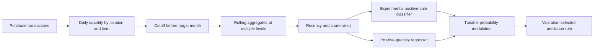

# Feature analysis

The forecasting target is monthly `quantity` for each `(location, item_id)` pair. Features are computed using data available before the target month so that the model does not see future sales.



For example, an April target uses observations through **2025-03-31**. The December validation target uses observations through **2025-11-30**. This cutoff is applied before joining the feature tables to the target pairs.

## Feature groups

| Group | Examples | Why it is useful |
| --- | --- | --- |
| Pair history | `pair_qty_all`, `pair_qty_30d`, `pair_qty_90d`, `pair_qty_180d`, `pair_qty_365d`, active days, days since last sale | Captures the specific location-item demand pattern and recency. |
| Item history | Rolling quantity and active days for `item_id` | Captures an item's overall popularity across locations. |
| Location history | Rolling quantity and active days for `location` | Captures store or location scale and recent traffic. |
| Category history | Aggregates for `category_l1` and `category_l2` | Shares signal across related products when a pair has sparse history. |
| Brand history | Rolling aggregates for `brand` | Captures brand-level demand and recognition. |
| Location-category history | Aggregates for `(location, category_l1)` | Captures local preferences by product group. |
| Item metadata | `price`, category fields, `brand`, `manufacturer`, `size` | Adds stable product information and categorical context. |
| Derived ratios | Recent location share, pair-to-location share, pair-to-item share | Normalizes demand by the scale of the location or item. |
| Calendar context | Target month and target-month day count | Lets the model adjust for month length and seasonality. |

## Transformations

- Transactions are filtered to purchase events and aggregated to daily quantity by location, item, and date.
- The rolling windows are 30, 60, 90, 180, and 365 days.
- Missing numeric aggregates are filled with zero; missing categorical values become `unknown`.
- Last-sale timestamps are converted to `days_since_sale` relative to the feature cutoff.
- Monthly targets are normalized for excluded anomaly days by scaling valid-day totals to the full calendar month.

## Naming convention and formulas

Most numeric features follow this pattern:

```text
{level}_qty_{window}d
{level}_active_days_{window}d
{level}_days_since_sale
```

Here, `level` can be `pair`, `item`, `location`, `cat1`, `cat2`, `brand`, or `loc_cat1`; `window` is one of `30`, `60`, `90`, `180`, or `365`. The all-history variants use `_qty_all` and `_active_days_all`.

The notebook also creates these explicit ratios:

```text
pair_recent_share_30_90     = pair_qty_30d / (pair_qty_90d + 1)
item_recent_share_30_90     = item_qty_30d / (item_qty_90d + 1)
location_recent_share_30_90 = location_qty_30d / (location_qty_90d + 1)
pair_item_share_90d         = pair_qty_90d / (item_qty_90d + 1)
pair_location_share_90d     = pair_qty_90d / (location_qty_90d + 1)
```

The `+1` stabilizes ratios when the denominator has little or no recent history. A `days_since_sale` value of `999` represents a missing historical sale date.

## Model input and target handling

The model receives 109 columns in the recorded run. Categorical columns include location, item, category, brand, manufacturer, and size. The target is split into:

1. a binary positive-sale label (`quantity > 0`) for `CatBoostClassifier`;
2. the raw positive quantity for `CatBoostRegressor` with MAPE loss.

The implementation can multiply classifier probability by the positive-quantity estimate. However, the recorded validation selected `proba_power=0.0`, `threshold=0.0`, `blend=0.0`, and `scale=0.67`. Therefore classifier probability did not affect the recorded final prediction. Its effective formula was approximately `round(max(0, regressor_quantity) * 0.67)`.

The feature table is shared by both model stages. The classifier consumes all sampled pairs with a binary target (`quantity > 0`). The regressor consumes only positive rows, so it learns the amount sold conditional on a sale occurring. This hurdle design remains an experiment supported by the code; the validation-selected recorded configuration behaves as a scaled regressor.

## Leakage and sparsity controls

- Feature tables are built from dates `<= cutoff`; the target month is never used to construct its own predictors.
- The seven known anomaly dates are removed before monthly aggregation and valid-day normalization.
- Negative examples are sampled from the candidate location-item grid and anti-joined against the complete set of observed positive keys before the positive rows are downsampled.
- Numeric missing values are filled with zero and categorical missing values with `unknown`, allowing cold or sparse pairs to remain in the prediction grid.

The timestamp cutoff protects transaction aggregates, but `items.parquet` may be a final metadata snapshot. Point-in-time correctness of `sale_status`, price, and category fields still needs source-data verification.
