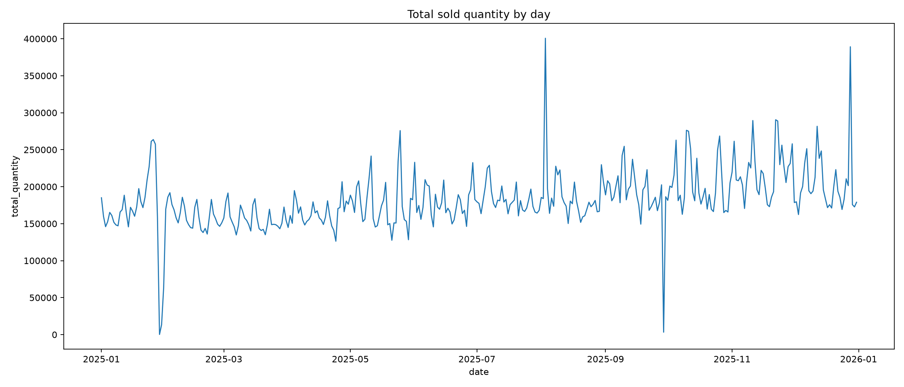
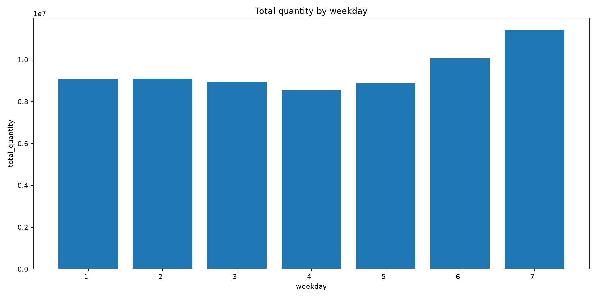
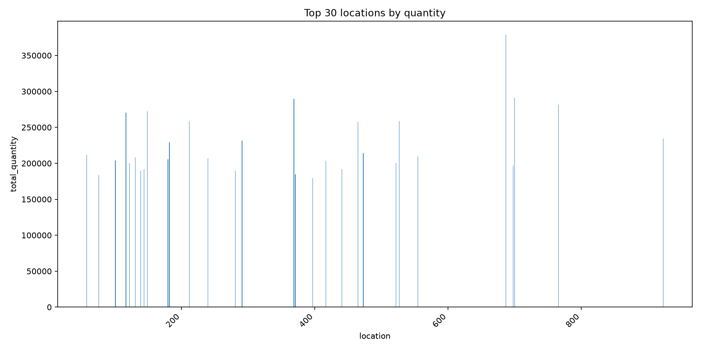
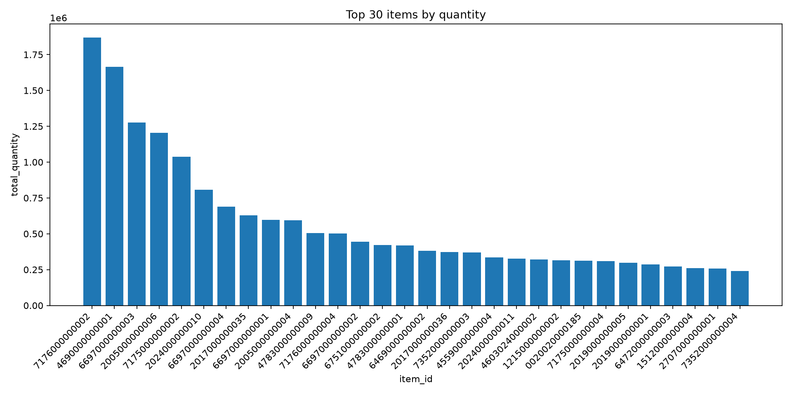
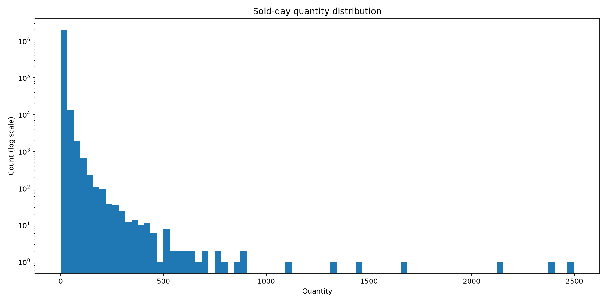
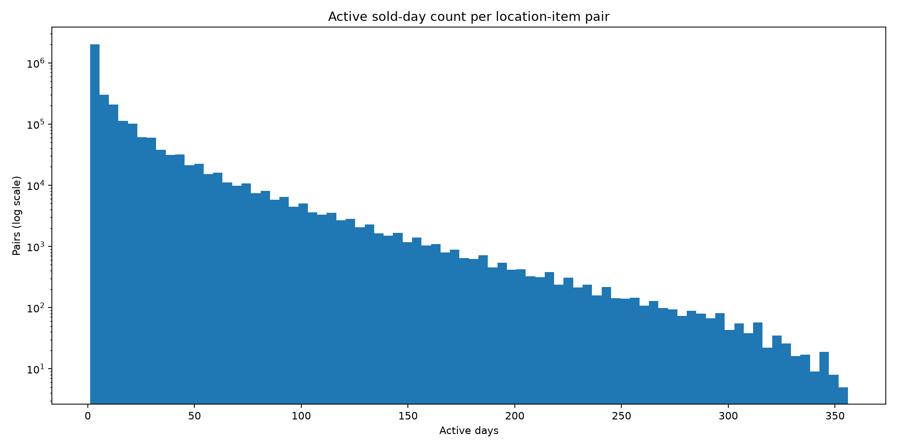

# EDA report

This report was generated from the local Parquet inputs with [`scripts/run_eda.py`](../../scripts/run_eda.py).

## Snapshot

| Metric | Value |
| --- | ---: |
| Date range | 2025-01-01 to 2025-12-31 |
| Non-zero pair-days | 35,324,041 |
| Sold location-item pairs | 3,144,558 |
| Locations | 1,038 |
| Items in transactions | 20,393 |
| Total quantity | 65,985,689 |
| Mean quantity on a sold pair-day | 1.868 |
| Median quantity on a sold pair-day | 1 |
| P90 quantity | 3 |
| P99 quantity | 14 |
| Maximum quantity | 2,497 |

## Charts

The CSV files in this directory contain the corresponding overview, date, weekday, top-location, top-item, top-pair, and volatile-pair tables.
